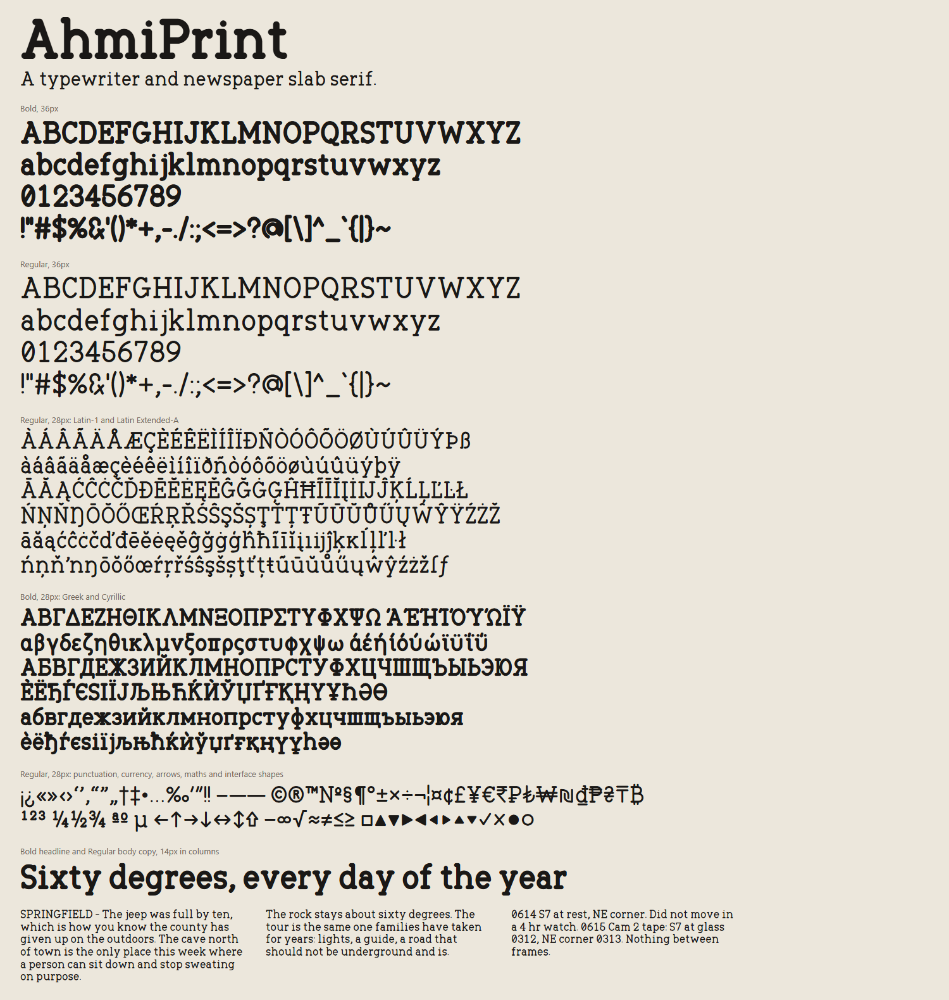

# AhmiPrint

AhmiPrint is a typewriter and newspaper slab serif in Regular and Bold.
It is drawn as strokes with round, ink-spread terminals and slab serifs, like a typewriter. Its proportional widths, tabular figures and large x-height come from newspaper text faces, so it stays readable at small sizes.

Version 1.101. The first public release is [v1.0.0](https://github.com/AhmiDarrow/AhmiPrint/releases/tag/v1.0.0).



## What's here

| Path | What it is |
|---|---|
| `fonts/` | Ready-to-use files: `AhmiPrint-Regular` and `AhmiPrint-Bold`, each as `.ttf` and `.woff2` |
| `source/ahmi-print.strokes` | The source. Every character drawn as strokes on a 24-unit grid |
| `build.py` | Turns the stroke file into the font files |
| `check.py` | Checks advances, holes, tabular figures, and that both weights share one set of metrics |
| `specimen.html` | Open in a browser to see every character |
| `LICENSE` | SIL Open Font License 1.1 |
| `CHANGELOG.md` | Release history |

## Using it on a web page

```css
@font-face {
  font-family: "AhmiPrint";
  src: url("fonts/AhmiPrint-Regular.woff2") format("woff2");
  font-weight: 400;
}
@font-face {
  font-family: "AhmiPrint";
  src: url("fonts/AhmiPrint-Bold.woff2") format("woff2");
  font-weight: 700;
}
h1 { font: 700 48px/1.2 "AhmiPrint", serif; }
p  { font: 400 16px/1.45 "AhmiPrint", serif; }
```

The caps and descenders are tall for the size, so give body text a line height of about 1.4.

## Using it on the desktop

Install `AhmiPrint-Regular.ttf` and `AhmiPrint-Bold.ttf`. On Windows, select both files, right-click, and choose Install. On macOS, open them in Font Book and choose Install. The family name is AhmiPrint. Bold is the bold style of that family.

The zip on the [release](https://github.com/AhmiDarrow/AhmiPrint/releases/tag/v1.0.0) has those files, the web fonts, this readme, and the specimen.

## Characters

584 characters in each weight, every one drawn from the stroke file:

- Basic Latin, Latin-1 Supplement and Latin Extended-A in full, plus Ș ș Ț ț, ƒ and the dotless j used under accents. That covers Western, Central and Northern European, Baltic, Turkish, Maltese, Welsh, Romanian and Esperanto.
- Greek: the modern monotonic alphabet with tonos and dialytika.
- Cyrillic: U+0400 to U+045F (Russian, Ukrainian, Belarusian, Bulgarian, Serbian, Macedonian) and Ґ ґ Ғ ғ Қ қ Ң ң Ү ү Ұ ұ Һ һ Ә ә Ө ө for Kazakh and Central Asian languages.
- Punctuation and symbols: curly quotes, dashes, daggers, bullet, ellipsis, per mille, primes, angle quotes, ‼, fraction slash; € ₹ ₽ ₺ ₩ ₪ ₫ ₱ ₴ ₸ ₿; ™ №; arrows ← ↑ → ↓ ↔ ↕ ⇧; − ∞ √ ≈ ≠ ≤ ≥; the interface shapes ◻ ▲ ▼ ► ◄ ⏴ ⏵ ⏶ ⏷ ✓ ✗ ● ○.
- Spaces: no-break, figure, punctuation, thin, hair and narrow no-break, each an empty glyph of its own width.

Accented letters are composed. Each mark (acute, grave, circumflex, caron, breve, dot, ring, tilde, macron, diaeresis, double acute, cedilla, ogonek) is drawn once as its spacing character, and a letter is its base plus the mark, written as two `use` lines in the stroke file. Lowercase letters take the mark as drawn; capitals take it squashed to half height so it sits low over the cap. Greek and Cyrillic letters that look like Latin ones use the Latin drawing.

The drawing grid is 24 units tall: baseline 0, x-height 14, cap height 20, ascender 21, descender -6. The em is 1000 units. Line spacing is the same as in 1.000 and shared by both weights: ascent 1038, descent -329, no line gap, in both the hhea and the typo metrics, with USE_TYPO_METRICS set. Marks over capitals may rise above that ascent, as in most fonts. The Windows metrics (usWinAscent 1152, usWinDescent 349) cover every glyph, so nothing is clipped. Regular is stroke weight 2.6 and Bold is 3.8, both with round caps and round joins. Slab serifs are strokes of the same weight as the stems. Letters are proportional. The zero is slashed, and every figure, the figure space and the figure dash have the same width so columns of numbers line up.

## Changing a letter

1. Edit its strokes in `source/ahmi-print.strokes`. The comments at the top of that file explain the commands.
2. Rebuild:

```bash
pip install fonttools brotli skia-pathops
python build.py
python check.py
```

`build.py` expands every stroke to a filled outline, removes the overlaps, and writes the `.ttf` and `.woff2` files. Advance widths come from the stroke file and are the same in both weights.

## About

AhmiPrint was made for the newspapers and typed reports in Springfield MO, a Project Zomboid map. It is built the same way as Remedy Sans.

Hope this helps
- Ahmi

## License

AhmiPrint is licensed under the [SIL Open Font License, Version 1.1](LICENSE). You can use it freely in personal and commercial projects, embed it in apps, games and websites, and modify or redistribute it under the same license. The font itself may not be sold on its own. There is no Reserved Font Name.
